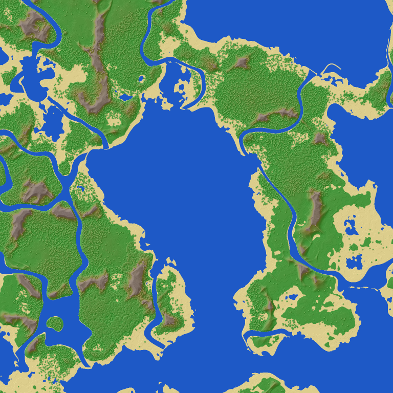
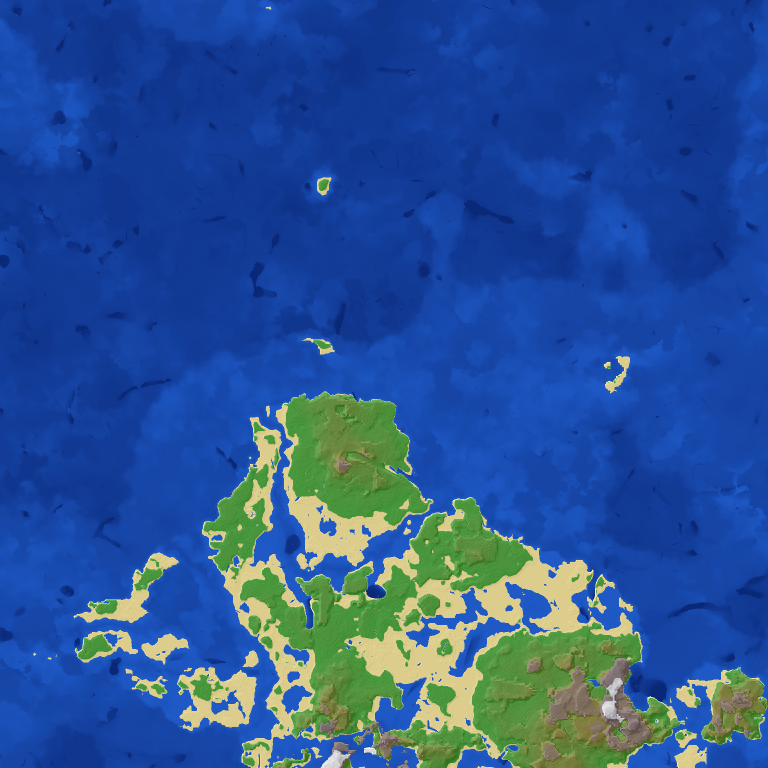

# Vanilla terrain generation on an ESP32: research and plan

Status: research, a measured prototype of the terrain shape, and a plan (October 2026).
Goal: worlds that look and play like vanilla 1.21.8 (all the biomes, the terrain shapes,
caves, features and structures), not a bit-identical copy of a vanilla world for the same
seed, on an ESP32-S3 (240 MHz, two cores, single-precision FPU, 8 MB PSRAM, 16 MB flash).

## Summary

- Vanilla's generator (1.18+) is mostly **data**: the 1.21.8 server jar's data pack holds
  the noise router (35 density function files, 60 noises), the surface rule, 65 biomes,
  carvers, 258 placed and 224 configured features, 34 structures with 188 template pools
  and 1,202 structure templates. A generator that runs this data looks like vanilla
  without copying vanilla's Java.
- **The terrain shape is feasible on the chip.** A prototype (`mc/world/vanilla`) compiles
  the 1.21.8 noise router into C and evaluates it in floats: vanilla's continents, ocean
  depths, mountains, archipelagos and caves. On the board one chunk took **1,300 ms** as a
  plain interpreter and **300-350 ms** after five optimisations; as generator version 3
  with the shape's exact optimisations (Stage 1 below) a whole chunk takes **140 ms**
  (today's generator: 30-60 ms).
- It is **deterministic across the PC and the ESP32** (identical chunk fingerprints), as
  today's generator is: worlds stay the same on both.
- What is not data: the overworld's biome parameter table (`OverworldBiomeBuilder`, about
  7,600 points built by code), the feature implementations (trees, ores, geodes, ...),
  the hard-coded structures (strongholds, fortresses, mineshafts, monuments, mansions,
  temples, ...) and jigsaw assembly. These are ported, in that order of value.
- Flash: the structure templates are 6.2 MB as shipped (gzip NBT); re-encoded (palette
  and run lengths, only what the world needs) they fit a 2-3 MB data partition.

| Today's generator | The vanilla prototype (terrain shape only) |
|---|---|
|  |  |

*The same 1,536 x 1,536 blocks around the origin (seed 42), coloured by height: water
below sea level (darker: deeper), sand near it, then green, brown and white. Left: today's
generator (heights include water and trees). Right: the prototype's terrain shape, no
surface materials, no features yet. Rendered by `tools/worldgen/render_maps.js` from the
host test `vanilla_density_height_maps`.*

## How vanilla generates a chunk

A chunk passes through these statuses (`ChunkStatus`), each reading neighbours up to a
range:

1. **structure_starts / structure_references**: does a structure start in this chunk
   (structure sets: random spread with spacing/separation and salt, or concentric rings
   for strongholds), and which nearby starts reach into it.
2. **biomes**: a biome per 4 x 4 x 4 cell (quart), from six climate parameters sampled
   from the noise router (temperature, humidity/vegetation, continentalness, erosion,
   depth, weirdness), nearest point of the dimension's parameter list.
3. **noise**: the terrain. `final_density` at the corners of 4 x 8 x 4 cells, trilinear in
   between; stone where it is positive, else water below the aquifer's level, air above.
   Aquifers decide local water and lava levels underground; ore veins replace stone.
4. **surface**: the surface rule (a data-driven condition tree) replaces the top layers:
   grass and dirt, sand and sandstone, terracotta bands, snow, ice, mud, gravel, ...
5. **carvers**: classic caves and canyons cut afterwards (from chunks up to 8 away).
6. **features**: the biome's placed features in 11 steps (lakes, local modifications,
   underground structures, surface structures, strongholds, underground ores,
   underground decoration, fluid springs, vegetal decoration, top layer modification),
   each with placement modifiers (count, rarity, height range, in square, biome filter,
   surface/height map, ...).
7. **light, spawn**: light and initial mobs (this server does its own light already).

### The noise router (1.21.8 overworld, measured with `tools/worldgen/analyze_router.js`)

- Height 384 (y -64..319), cells 4 x 8 x 4: **1,225 corners per chunk** (5 x 49 x 5).
- `final_density`: 28 noises, up to **176 Perlin octave samples** per corner; many are
  cave branches skipped by `range_choice` (measured: ~55,000 octave samples per chunk).
- The 2D parts (continentalness, erosion, ridges, the offset/factor/jaggedness splines with
  430 points) are cached per 4 x 4 column (`flat_cache`, `cache_2d`).
- The 3D base terrain is the legacy `old_blended_noise` (8 + 16 + 16 octaves); caves are
  noise caves (cheese, spaghetti 2D/3D, noodles, pillars, entrances).
- Only 17 nodes of `final_density` are evaluated per block; the rest is interpolated.
- 219 density function nodes in all (a DAG), 118 splines, 27 noises (83 octaves).

## The prototype (`lib/mcore/src/mc/world/vanilla`)

- `tools/worldgen/compile_router.js` reads the data pack's noise router and writes
  `router_data.cpp` (nodes, splines, noise parameters) and `router_gen.cpp` (**the router
  as C code**: one function per node, constants inlined, memoised only where a node is
  shared).
- `density.cpp`: vanilla's algorithms in single-precision floats: `ImprovedNoise` (with
  vanilla's gradient table), `PerlinNoise` octaves, `NormalNoise`, the legacy
  `BlendedNoise` with its y smear, cubic splines (`CubicSpline.Multipoint`), every density
  function type the overworld uses, flat and 2D caches, cell interpolation as
  `NoiseChunk` does it. Not vanilla's seeding (Xoroshiro, positional random): the noises
  are vanilla's in shape and scale, the world for a seed is not vanilla's.
- Tests (`host/tests/test_vanilla_density.cpp`): plausible terrain (66% land, surfaces
  mostly y 50-80, mountains to y 176, caves, every climate parameter in vanilla's range),
  the approximations against the exact result, the generated code against the
  interpreter (identical), a fingerprint the board must match.
- On the board: `/vanillabench [chunks] [octave cut] [cell margin] [shared permutation]
  [generated]` (operator command; runs in its own thread, results in the log).

### Measured (8 chunks each; board: ESP32-S3 at 240 MHz, one core, idle server)

| Step | PC (ms/chunk) | Board (ms/chunk) | Blocks that differ from exact |
|---|---|---|---|
| Interpreter, exact | 13.6 | **1,300** | - |
| + memo arrays in internal RAM, cell-wise interpolation | 10.9 | 1,038 | 0 |
| + skip cells whose corners are all clearly solid or air (margin 0.1: 43-52% of cells) | 8.8 | 764 | 0.002% |
| + drop octaves weighing < 1/64 of their noise | 7.9 | 709 | 0.016% (surface height off by 0.04 on average) |
| + one permutation table for all octaves (internal RAM) | - | 629 | (distinct noises, not vanilla's values) |
| + `ImprovedNoise` without `floorf` and with a gradient switch (1.6 instead of 2.55 us per sample) | - | 566 | 0 |
| + the router compiled to C (`router_gen.cpp`) | 5.6 | 376 | 0 |
| + blocks written in memory order (layer by layer) | 5.6 | **300-350** | 0 |

Where the board's time goes now: ~180 ms for the corners (55,000 octave samples at
~1.6 us, plus the router), ~130-170 ms for the blocks in cells near a surface.

### Since then

Stage 1 below: the air above the terrain bounded and skipped, cells proven solid or air
by interval arithmetic, the per-block expression generated as one function, the blocks
written a section at a time: 140 ms a chunk for generator version 3 on the board.

## The plan

Vanilla's world generation, step by step, each built so that the world feels the same
while the chip does far less work than vanilla's Java does. Each stage is its own
generator version (worlds keep the version they were made with), tested on the PC
(fingerprints in `GENERATOR_GOLDEN`, statistics against the real 1.21.8 server's worlds:
heights, biome shares, block counts per depth) and measured on the board (`MC_BENCH`:
milliseconds per chunk and per step) before the next one starts. The classic generator
(version 2) stays the default until the vanilla one is complete; new worlds choose it with
`MC_GENERATOR 14`, `--generator 14` or the world reset in `/menu` (which takes the newest
vanilla version).

**Stage 0: prerequisites** (done). The world height -64..319; the data pack in
`tools/vanilla/1.21.8` for the generators' tables; vanilla's data generator reports
(`java -DbundlerMainClass=net.minecraft.data.Main -jar server.jar --reports --output
tools/vanilla/1.21.8`, Java 21: a portable JRE is enough) for what exists only as code.

**Stage 1: the terrain shape, fast.** Vanilla evaluates every density function at all
1,225 cell corners and every block of a chunk. Here:
- *A bound on the air above the terrain*: final_density's range over a corner column and
  every y above a height, by interval arithmetic over the router (the 2D parts exact from
  the column, each noise at its largest possible value, `Router::interval`). Cells above
  it are air for certain and their corners are never evaluated.
- *The sign slot*: final_density is not above 0 where its main interpolated node is not
  (a chain of sign-keeping functions under a `min`, found in the router at start-up), so
  cells whose 8 corners have it at or below 0 are air without the noodle caves' four
  noises, and so are blocks where it is.
- *Cells proven whole*: final_density's interval over a cell from its corners' ranges (a
  trilinear lerp stays within its corners) fills cells all solid or all air without
  per-block work.
- *The per-block expression* as one generated function (`blockDensity`), the x and z
  lerps shared over a cell, the 2D values (`flat_cache`) of the 25 corner columns in a
  table, the octaves of all noises in one block of internal RAM.
- *The blocks written a section at a time* (`Section::assign`: the palette and the packed
  data in one pass) instead of 100,000 single `set` calls, the PSRAM block mask read a
  row at a time, the heightmap from the column tops.
- *Both cores*: one router per worker thread.
All of this is exact: the same blocks as evaluating everything (the fingerprints did not
change, a test compares chunks with and without). Measured on the board (ms a chunk,
81 chunks, seed 42):

| Step | Version 3 | Shape | Corners | Blocks | Writing the blocks |
|---|---|---|---|---|---|
| Before (generator v3 as first committed) | 394 | 300-350 | | | ~50 |
| + the air bound | 275 | 166 | 99 | 67 | 109 (with the rest) |
| + sections written whole, rows read in order | 173 | 150 | 99 | 51 | 16 |
| + the per-block expression, shared lerps | 169 | 146 | 96 | 49 | 16 |
| + cells proven whole by intervals | **140** | **117** | 96 | 20 | 16 |

The rest is the noises themselves: 30,000-34,000 octave samples a chunk at 1.65 us each
(the blended noise 2.1 us), about 55 ms; the corners' other work about 30 ms. Tried and
dropped: the noise code in IRAM (no change: it stays in the cache), a branch-free gradient
(slower: the table loads cost more than the branches), proving corners air from the
blended noise alone (the proof cost what it saved).

**Stage 2: biomes** (done: generator version 4). Vanilla picks the parameter list's entry
nearest to the climate (temperature, humidity, continentalness, erosion, depth,
weirdness) with an R-tree over `OverworldBiomeBuilder`'s 7,593 points (the data
generator's `biome_parameters` report). Those points are 3,795 surface entries, each at
depth 0 and 1, and three cave biomes; the surface entries tile a 5 x 5 x 7 x 7 x 13 grid
in the five other parameters exactly. So `tools/worldgen/compile_biomes.js` compiles them
into a 15,925-byte table (`biome_table.cpp`): five interval searches and one read give
the surface biome, the distance to the grid's edge stands for vanilla's distance outside
it, and the three cave entries are compared by distance as vanilla does
(`biomes.cpp`). Checked against a brute-force nearest entry at 20,000 random climates:
the same everywhere but at exact ties (vanilla's R-tree order decides those). The climate
is read once per 4 x 4 column (at its corner, where vanilla samples: the 2D values from
the router's column table), the depth per 4 x 4 x 4 cell. Chunks keep a column's biome
(the one at its surface: weather, snow, spawning, the surface) and, where caves differ,
3D biomes per section (sent to clients and stored: `FLAG_BIOMES_3D`). Over 144 chunks
spread across 6,000 blocks: 43 biomes, oceans 37% of the columns, lush and dripstone
caves and the deep dark only far below the surface. The provisional surface and the
trees know the new biomes (badlands, mushroom fields, old growth taigas, ...). Board:
6.4 ms a chunk more than version 3 (145 ms in all). Not yet: comparing the biome shares
with worlds the real 1.21.8 server generates.

**Stage 3: the surface rule** (done: generator version 5). `noise_settings/overworld.json`'s
rule (30 KB of JSON: sequences of conditions on biome, depth into the stone, water, y,
noises, steepness and temperature) compiled by `tools/worldgen/compile_surface.js` into
tables (`surface_rules.cpp`) that `surface.cpp` walks as vanilla's `SurfaceSystem` does:
per column the surface depth from the `surface` noise, the minimum surface level from
the preliminary surface (`initial_density_without_jaggedness` at the 25 corner columns,
now a root of the compiled router), then from the column's top down the stone depth above
and below, the water height and the 3D biome of each block. Cheaper than vanilla's in
three exact ways:
- only the part under `above_preliminary_surface` runs, and only from a column's top
  down to its minimum surface level: below it vanilla's rule changes nothing but bedrock
  and deepslate, which the generator places;
- the rule is compiled once per biome with the biome conditions decided (65 small rules
  instead of one with 39 biome tests);
- per biome and surface depth, the deepest stone depth any of its rules reaches (most
  biomes: 1 + the surface depth; deserts 31 more; badlands without a limit for their
  bands): deeper blocks are not evaluated.
The rule writes into the block mask before the sections are written, so it costs no
block writes. The badlands bands are vanilla's algorithm with this generator's random
numbers; the eroded badlands' pillars and frozen oceans' icebergs (code in vanilla, not
rule) are not done yet. Over 144 chunks: the land's top 75% grass, 8% sand, podzol,
snow, terracotta, mud; sea floors 45% gravel, 26% sand, 23% dirt (rivers: vanilla's
disks of sand and clay come with the features). Board: 10 ms a chunk (35 ms before the
per-biome rules and depth limits: 6,868 blocks evaluated, now 987); version 5 155 ms
in all.

**Stage 4: aquifers and ore veins** (done: generator version 6). Before it every cave
below the sea level was flooded; now `aquifer.cpp` runs vanilla's `NoiseBasedAquifer`
for the empty blocks under each column's top: the jittered 16 x 12 x 16 grid of
aquifer locations, each location's fluid level and type computed once a chunk (from the
`fluid_level_floodedness`, `fluid_level_spread` and `lava` noises, the preliminary
surface 13 chunks around, the deep dark dry), the nearest four locations, the pressure
between them and the `barrier` noise deciding where a wall of stone stays. Below y -54
everything empty is lava (vanilla's global fluid), above the column's top the global
fluid as before. Differences from vanilla: the density a barrier is compared with is an
upper bound (the sign slot's chain; the noodle caves' part is left out), the preliminary
surface is sampled on a 16-block grid (vanilla: 4) so that neighbouring chunks share it,
fluids at aquifer edges are not scheduled to flow. Then vanilla's `OreVeinifier`: the
toggle lerped over cells from its corners, copper (with granite) where it is above 0 in
y 0..50, iron (with tuff) below 0 in y -60..-8, the ridges' corners only where a cell
needs them, cells whose corners cannot reach the threshold left out. Over 64 chunks:
caves (y -54..62 under the terrain) 81,510 blocks of air, 20,537 of water, 199 of lava;
veins with their granite and tuff in their ranges. Board: about 19 ms a chunk more than
version 5 (175 ms in all; the aquifer's blocks are the larger part, 9 fluid statuses
2 ms, veins 5 ms). Done with floats: the ESP32-S3 has no double-precision hardware
(with doubles: veins 32 ms).

**Stage 5: carvers** (done: generator version 7). `carvers.cpp` ports vanilla's
`CaveWorldCarver` (configured carvers `cave`, 15% of the chunks, y -56..180, and
`cave_extra_underground`, 7%, y -56..47: rooms, tunnels that wander and split, floors)
and `CanyonWorldCarver` (`canyon`, 1%, y 10..67: tall, narrow, with width factors per y),
started by the chunks up to 8 away as in vanilla, after the surface rule. Every overworld
biome has these three carvers. A tunnel stops as soon as it can no longer reach the chunk
(vanilla's `canReach`), so far starts cost a few steps. Carved blocks are those of the
overworld's carver replaceables (stone, dirt, grass, sand, terracotta, ores, snow,
gravel, ...); what fills them is the aquifer's substance at density 0 (water, lava, air,
or a barrier the carver leaves), lava at y -56 and below; cutting through grass turns the
dirt below into grass. This generator's random numbers (32-bit xoshiro128**, fast on the
ESP32), vanilla's shapes and draws in vanilla's order. Over 36 chunks: air in y -60..39
23,078 blocks without carvers, 43,134 with; about 66 starts around a chunk. Board: about
24 ms a chunk more (version 7 195 ms in all; a chunk with many tunnels: 44 ms of carving).
Not done: vanilla caches the starts it has found in a chunk's structure data; here every
chunk walks its 867 neighbouring starts again (most end after one random number).

**Stage 6: features** (first part done: generator version 8). `tools/worldgen/compile_features.js`
compiles the overworld biomes' feature lists (eleven decoration steps), their 164 placed
features with the features nested in them (250 placed, 204 configured, 783 placement
modifiers) into tables (`feature_data.cpp`: block states and tags as names, resolved
when a generator starts). `features.cpp` runs them as vanilla's decoration does: for
each step, each placed feature of a biome in the chunk (column and cave biomes), seeded
by chunk, step and feature; the 13 placement modifiers (count, rarity, in square,
height range, heightmap, biome, block predicate, water depth, environment scan, surface
relative threshold, noise counts, random offset) give the positions, and the feature
types done so far place at each: ores (vanilla's blob of spheres, discarded where exposed
to air when the feature says so), trees (the generator's shapes for vanilla's oak,
birch, spruce, jungle, acacia and dark oak trees), random patches and flowers, single
blocks (two-tall plants too, each where it can survive), seagrass, kelp, disks of sand,
clay and gravel, springs, block columns (sugar cane, cactus), freezing (ice and snow),
and the selectors that choose among them. Ores run on the block mask before the sections
are written (a byte per block, the codes of the stones they replace looked up in a table
per block set), the others on the chunk. Not done yet: lakes, geodes, dungeons, fossils,
icebergs, dripstone, corals, huge mushrooms, moss and lush cave patches, glow lichen,
bamboo, vines, fallen trees and a few more (28 types; the generator counts what it
leaves out). The one real departure from vanilla: a feature stays inside its chunk (a
tree whose crown would cross the border is left out, a patch's blocks outside are
dropped). Vanilla decorates a chunk once its neighbours exist and lets features reach
into them; here a chunk is generated alone, and doing the same needs chunk states in
the server (generated, decorated) that wait for the neighbours. Over 100 chunks: trees,
grass and flowers on the land, coal, iron, copper, gold, redstone, lapis and diamonds
in their ranges, seagrass and kelp in the sea, snow and ice where it is cold. Board:
about 36 ms a chunk (ores 28 of it: their voxels are random reads of the PSRAM mask),
version 8 231 ms in all.

**Stage 7: structures** (first parts done: generator versions 10 to 14).
`tools/worldgen/compile_structures.js` compiles the 20 structure sets (placement, salt,
spacing, separation, spread type, frequency and its reduction method, exclusion zone;
the strongholds' rings), the 34 structures (type, biomes from their tags as a bit set,
step, terrain adaptation) and the 27 chest loot tables into `structure_data.cpp`.
`structures.cpp` places them as vanilla does: a random spread set's candidate chunk per
region from Java's `Random` seeded as WorldgenRandom (`java_random.h`), so a seed's
candidate places are vanilla's; the frequency's four reduction methods; several
structures in a set chosen by weight, one that cannot stand there giving way to the
next. Whether a structure stands there is decided from the terrain probe: the router's
final density down a column (WORLD_SURFACE_WG and OCEAN_FLOOR_WG heights) and vanilla's
biome at the start's quart, never a generated chunk's blocks; the start and its pieces
are then a pure function of the seed and the start chunk, cached (1,024 starts) and
placed into every chunk they reach, clipped to it, before the features (vanilla's
postProcess with the chunk as the box): the same structure in whatever order its chunks
are generated. The pieces' coordinates, mirror and rotation follow StructurePiece
(`getWorldX/Z`, the orientation's mirror and rotation applied to facing, axis, sides,
stairs' and doors' handedness). Built so far: desert pyramids (towers, the treasure
room with its trap and four chests), jungle temples (both tripwire traps with
dispensers of arrows, the lever puzzle and its chests), swamp huts on their stilts and
buried treasure; chests and dispensers get vanilla's loot (pools, weights, counts, the
stacks split over the shuffled free slots; enchantments not yet). `/locate structure`
finds them. Board: finding and placing them adds under 1 ms a chunk on average (232.3
against 232.7 ms); a temple's start is evaluated once (22 ms), its blocks placed in
10 ms.

Version 11 adds the strongholds (`stronghold.cpp`): the 128 places on vanilla's
concentric rings from the world seed (ChunkGeneratorStructureState), each moved to a
preferred biome within 112 blocks by vanilla's search over its quarts (a random one of
the matches, from the place's own fork of the random numbers), made when a chunk near
it is first generated; then vanilla's StrongholdPieces with their weights, limits,
imposed five-way crossing, collisions, filler corridors and order of random numbers,
tried again until a layout has its portal room, and lowered below the sea. The twelve
piece types place their blocks (stone bricks cracked, mossy or infested by each block's
own random number, doors and grates, prison cells, libraries with their cobwebs,
chandeliers and chests, the portal room with lava, iron bars, the silverfish spawner's
block and twelve frames, each with an eye at 10 %). The server sets eyes of ender into
the frames and opens the portal when all twelve have theirs, and a thrown eye flies
towards the nearest stronghold (EyeOfEnder). Board: the rings' biome search for a
stronghold 0.31 s, once (a worker generating a chunk near it waits that long); a
stronghold's layout 3.4 ms; its start chunk placed in 13 ms (19 pieces, 2,271 blocks);
version 11 a chunk on average as version 10 (232.9 ms). The spawner keeps its
mob (a TILE_SPAWNER block entity, saved, sent to clients) and spawns as vanilla's
BaseSpawner (`spawners.cpp`). Not yet: the "bury" terrain adaptation (caves cut strongholds open
as they do in vanilla, but the terrain is not packed around them).

Version 12 adds the Nether fortresses (`fortress.cpp`): vanilla's nether complexes set
(a fortress or, by weight 3 to 2, a bastion, which is not built yet) and
NetherFortressPieces: the bridges, crossings, rooms, stairs, the blaze spawners'
thrones, the castle entrance with its lava well, the castle's corridors, stairs,
balconies and the stalk rooms with nether wart on soul sand, chests in the corridor
turns; pillars of nether bricks down into the lava sea; vanilla's weights, limits, "in a
row" rules and order of random numbers, lifted to y 48 to 70 as vanilla's
moveInsideHeights. The Nether gets its own terrain probe (its biome from temperature
and vegetation). Board: the 81 chunks around seed 42's fortress 147.3 ms a chunk against 144.6 without it (its layout made once, its pieces placed into each chunk); PC and board fingerprints match. Not yet: the fortress's own mob spawning (blazes
and wither skeletons inside its box; the spawners bring blazes), blazes' attacks and
drops (they only wander).

Version 13 adds the mineshafts (`mineshaft.cpp`): vanilla's MineshaftStructure (0.4 % of
chunks, legacy_type_3's chance; the badlands' kind in dark oak, raised towards the
surface by the terrain probe's height) and MineshaftPieces: the room with its dome and
openings, corridors (rails, supports where the ceiling holds them, torches, cobwebs,
cave spider corridors with their spawner, chest minecarts with the shaft's loot,
planks over gaps, fence posts down and chains up under their ends), crossings on one
or two floors and stairs, grown depth first in vanilla's order of random numbers; a
piece next to a liquid is left out of that chunk (isInInvalidLocation). The chest
minecarts are entities kept with the generated chunk until a player comes near.
Board: the 81 chunks around the origin (seed 42 has a mineshaft at chunk 4 0) 235.8 ms a chunk against 233.8 without mineshafts; PC and board fingerprints match.

Version 14 adds the jigsaw structures, villages (plains, desert, savanna, taiga, snowy)
and pillager outposts first. `tools/worldgen/compile_templates.js` re-encodes the 1,195
templates the game ships (6.2 MB of gzipped NBT): each template's palette as block state
names (resolved when a generator starts) and its blocks run-length coded over the
template, its jigsaw blocks (name, target, pool, final state, joint, priorities,
orientation), its containers' loot tables and its entities; the 188 template pools
(single, legacy single, list, feature and empty elements with their projection,
processors and fallback) and the 37 processor lists: 0.72 MB in the firmware
(`template_data.cpp`), no partition of its own. `templates.cpp` places a template as
StructureTemplate#placeInWorld: mirrored and rotated (blocks and states: facing, axis,
sides, rails, stairs, doors, chests, the 16-step rotation), structure blocks and a legacy
element's air left out, jigsaws replaced by their final state, the rule, rot and
protected-blocks processors with vanilla's random number per position (Mth.getSeed,
the same in every chunk), gravity for terrain-matching pieces (WORLD_SURFACE_WG of the
chunk before the piece), waterlogged where it goes into water, containers with their
loot, the template's mobs (villagers, golems, cats) kept with the chunk until a player
comes. `jigsaw.cpp` assembles them as JigsawPlacement: the start element from its pool
raised to the ground, then the pieces by placement priority, each jigsaw (shuffled, by
selection priority) offered its pool's elements shuffled by weight and the fallback's,
in four shuffled rotations, attached where the jigsaws face each other with matching
names (joints rollable or aligned) and fit the free space (the area around the start
less the pieces, or inside the parent for a jigsaw pointing into it), with the
expansion hack; rigid pieces keep their parent's height, terrain-matching ones follow
the ground; the outposts keep 10 chunks from the villages' places (the exclusion zone).
And the terrain follows the structures as vanilla's Beardifier makes it: from version
14 the structures are found before the terrain, their rigid pieces and jigsaw junctions
within 12 blocks of the chunk add vanilla's beard (beard_thin, beard_box), bury or
encapsulate contribution to final_density block by block (the router's shortcuts left
out in the cells they reach; the kernel computed by multiplication, the same floats
on every chip): houses stand on ground built up under them and cut away above, the
strongholds are packed into the rock. `tools/worldgen/render_structure.js` draws a
village from above and in cuts (the host test structures_render_village). Board:
a village's start chunk 400 ms (its terrain 246 ms, a chunk without
structures about 200; the beard is worked out block by block only where it can change the
block: the router's shortcuts stay with room for the most it can add below a piece's
ground and take above it); the overworld's 81 chunks around the origin 235.7 ms a chunk
as before; the names resolved through a hash table (a linear search took 8 s when a
world started). PC and board fingerprints match. Not yet: the feature elements (hay piles, trees and flowers in the villages'
pools), bastions, trail ruins, ancient cities, trial chambers, igloos, shipwrecks,
ocean ruins, ruined portals, fossils, End cities, mansions, monuments.

**Stage 8: the Nether and the End** (done: generator version 9). `compile_router.js`
takes a preset (`overworld`, `nether`, `end`) and writes each router into its own
namespace (`router_data_nether.cpp`, `router_gen_nether.cpp`, ...); a `RouterDef`
carries a router's nodes, noises, roots and shape (minimum y, height, cell size, sea
level), and the engine (the bound, the sign slot, the cell intervals) runs any of them.
The End's router adds `end_islands`: vanilla's EndIslandDensityFunction with its own
simplex noise, the main island and the outer islands from 1,000 blocks out (in integers
and doubles where vanilla's arithmetic would round differently on the chip).
- **The Nether** (`vanilla_dims.cpp`): the router's caverns in 4 x 8 x 4 cells, the lava
  sea below y 32, bedrock floor and roof thinning out over five blocks as vanilla's
  gradients; its five biomes (nether wastes, soul sand valley, crimson and warped
  forests, basalt deltas) from the temperature and vegetation noises, nearest point
  with vanilla's offsets; its surface rule compiled by `compile_surface.js nether`
  (soul sand and soul soil, nylium, basalt and blackstone, gravel and soul sand by the
  lava sea, the ceiling's own conditions); and its features: quartz and Nether gold
  ore, magma, blackstone, gravel and soul sand blobs (ores), lava springs, fire,
  glowstone blobs, huge fungi, Nether vegetation (roots, fungi, sprouts), weeping and
  twisting vines.
- **The End:** the router's main island and outer islands with the void between;
  vanilla's End biomes by chunk (TheEndBiomeSource: the main island's chunks, else
  highlands, midlands, barrens and small islands by the islands' height at the chunk's
  middle); the spikes on the main island; chorus plants on the highlands.

`compile_features.js` now compiles every biome's features (the overworld's first, so
their indices and with them version 8's worlds stay the same). Board: the Nether
136 ms a chunk, the End 142 ms (outer islands); PC and board fingerprints match.
Not done: the basalt deltas' delta features, basalt columns and pillars and their
blackstone and basalt blobs; end gateways and the small islands' floating end stone
(`end_island`); fortresses, bastions and End cities are structures (Stage 7).

## Costs and risks

- **CPU**: the shape is the largest single cost and is measured above. Surface rules,
  biomes and carvers are expected at 10-20 ms together; features depend on the biome
  (forests are the worst case) and are measured per feature type as they come.
- **Memory**: the router's noises take ~60 KB of PSRAM (permutation tables; one shared
  table: 256 bytes in internal RAM); corner values ~25 KB per worker; structure assembly
  needs a bounded piece list per start.
- **Flash**: router code ~45 KB (measured), feature and structure code a few hundred KB,
  templates 2-3 MB in a data partition (16 MB flash: room).
- **Determinism**: chunks are a pure function of the seed and position on both the PC and
  the ESP32 (identical fingerprints measured); this has to hold for every phase (no
  fused multiply-add differences: built with the same flags, checked by fingerprints in
  the unit tests and on the board).
- **Not 1:1**: different seeding, float instead of double, dropped octaves: the same kind
  of world, not the same world as vanilla for a seed. Seed-based tools (chunkbase) do not
  apply.

## Files

- `tools/worldgen/analyze_router.js`: the router's structure and cost.
- `tools/worldgen/compile_router.js`: the router as tables and as C.
- `tools/worldgen/compile_biomes.js`: the overworld's biome parameter list as a table.
- `tools/worldgen/compile_surface.js`: the surface rule as tables, one rule per biome (the
  overworld's and the Nether's).
- `tools/worldgen/compile_features.js`: every biome's features as tables.
- `tools/worldgen/compile_structures.js`: structure sets, structures and chest loot tables.
- `tools/worldgen/compile_templates.js`: structure templates, template pools, processor lists.
- `tools/worldgen/render_structure.js`: a structure's top view and cuts as PNG.
- `tools/worldgen/render_maps.js`: height maps as PNG.
- `lib/mcore/src/mc/world/vanilla/`: the router (`density.h`, `density.cpp`,
  `router_data.cpp`, `router_gen.cpp`), the biomes (`biomes.h`, `biomes.cpp`,
  `biome_table.cpp`), the surface rule (`surface.h`, `surface.cpp`, `surface_rules.cpp`),
  aquifers and ore veins (`aquifer.h`, `aquifer.cpp`), carvers (`carvers.h`, `carvers.cpp`),
  features (`features.h`, `features.cpp`, `feature_data.cpp`), structures (`structures.h`,
  `structures.cpp`, `structure_build.h`, `stronghold.cpp`, `fortress.cpp`, `mineshaft.cpp`, `templates.h`,
  `templates.cpp`, `jigsaw.cpp`, `template_data.cpp`, `structure_data.cpp`,
  `java_random.h`), polynomial sin and cos
  (`fastmath.h`).
- `lib/mcore/src/mc/world/vanilla_gen.cpp`: generator versions 3 and up;
  `vanilla_dims.cpp`: version 9's Nether and End.
- `host/tests/test_vanilla_density.cpp`, `host/tests/test_vanilla_gen.cpp`: tests and
  measurements.
